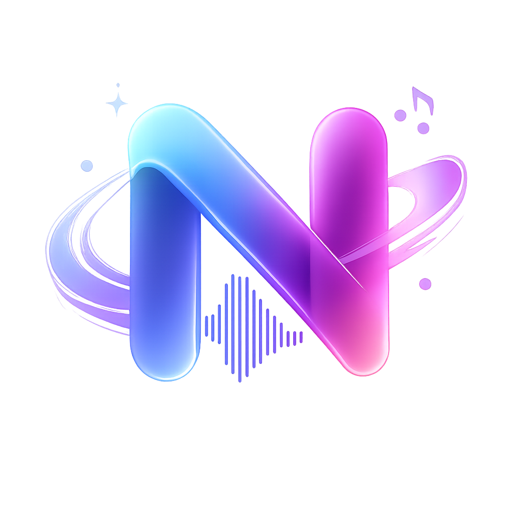
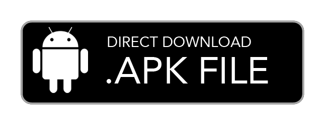
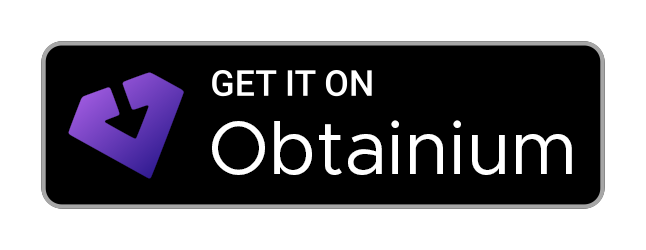
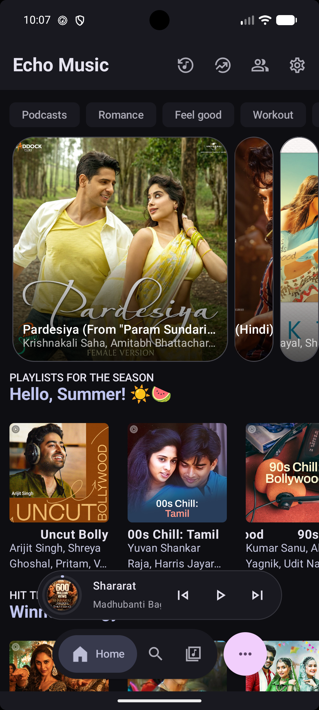
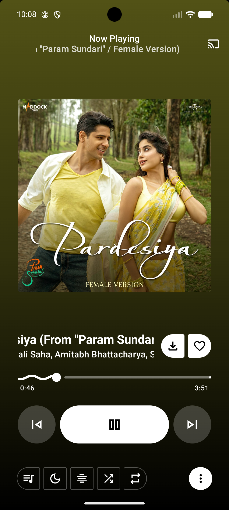
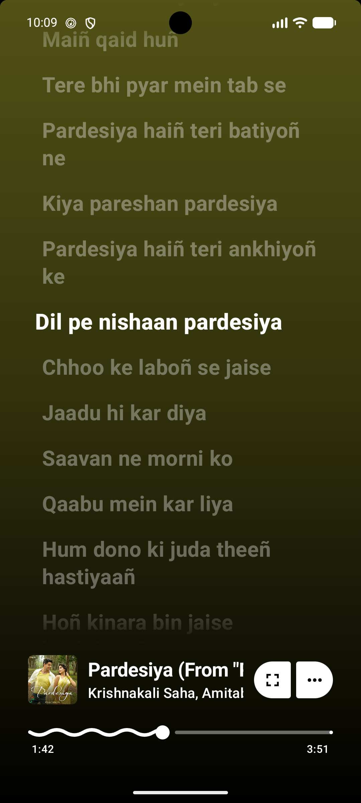
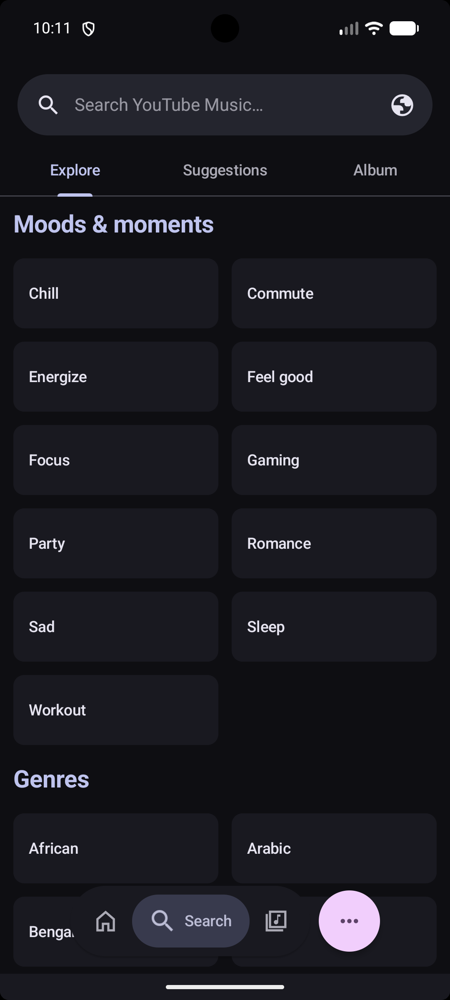
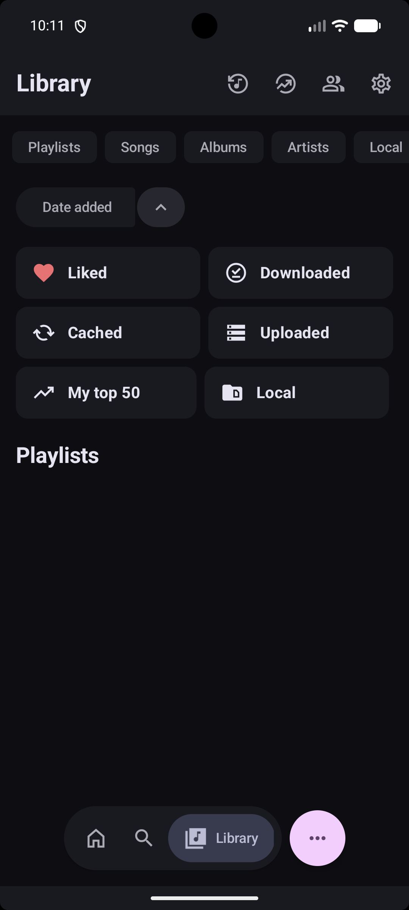
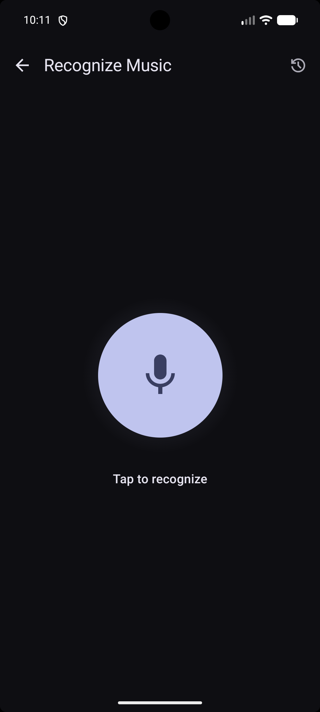

  

  <h1>NexMusic</h1>

  
<b>A modern Android music app with ad-free streaming, synced lyrics, offline playback, and an intuitive user experience.</b>

  

    
    
    
  

  

    
    
  

  

    
    
  

  
<b>Already have NexMusic installed?</b> The app checks for updates automatically. You can also grab the latest APK from <a href="https://github.com/nexerisltd/NexMusic-Android/releases/latest">GitHub Releases</a>.

---

## Overview

NexMusic delivers a seamless listening experience by leveraging YouTube Music's library without the ads. It adds offline downloads, real-time synchronized lyrics, music recognition, home-screen widgets, and deep customization.

## Screenshots

    
    

## Build from source

See [SETUP.md](SETUP.md) for the toolchain and signing setup.

## Community & Support

- Telegram: [t.me/nexappog](https://t.me/nexappog)
- Discord: [discord.gg/P44QdHPtKg](https://discord.gg/P44QdHPtKg)
- Issues: [GitHub Issues](https://github.com/nexerisltd/NexMusic-Android/issues)

## Special Thanks

NexMusic stands on the shoulders of several excellent open-source projects. Sincere thanks to:

| Project                                                                                                                   | Description                                         |
| :------------------------------------------------------------------------------------------------------------------------ | :-------------------------------------------------- |
| **[Metrolist](https://github.com/MetrolistGroup/Metrolist)** & **[Vivi Music](https://github.com/vivizzz007/vivi-music)** | Foundational inspiration and architecture reference |
| **[ArchiveTune](https://github.com/koiverse/ArchiveTune)**                                                                | Material You UI inspiration                         |
| **[Better Lyrics](https://better-lyrics.boidu.dev/)**                                                                     | Lyrics enhancement and synchronization              |
| **[SimpMusic](https://github.com/maxrave-dev/SimpMusic)**                                                                 | Lyrics implementation reference                     |
| **[Music Recognizer](https://github.com/aleksey-saenko/MusicRecognizer)**                                                 | Audio recognition (Nex Find)                       |
| **[BravePipe](https://github.com/bravepipeproject/BravePipe)**                                                            | Decryption handling and backup playback engine      |

---

---

## Legal Disclaimer & Terms of Use

### 1. 100% Free, Open-Source & Strictly Non-Commercial

NexMusic is a fully open-source project (FOSS) created purely for educational purposes and personal use. We do not sell this application, nor do we monetize it in any way. There are no advertisements, no premium features, no subscriptions, and no hidden fees within the app. This project has absolutely no commercial value or financial intent.

### 2. A Custom Browser with Content Filtering

NexMusic acts strictly as a specialized, third-party web browser and client. It simply parses the publicly available website content and APIs of YouTube and YouTube Music, rendering them in a custom user interface. The ad-free experience it provides is fundamentally no different from using a standard web browser (like Chrome, Firefox, or Brave) equipped with a common ad-blocking extension (such as uBlock Origin).

### 3. Support Content Creators

We deeply respect the hard work of artists, musicians, and content creators. We strongly encourage all users to subscribe to [YouTube Premium](https://www.youtube.com/premium). Purchasing a Premium subscription is the best way to financially support the creators you listen to and ensure the continued growth of the platform. NexMusic is built as a proof-of-concept for developers and enthusiasts, not to harm creators' revenues.

### 4. No Hosting of Copyrighted Material

We do not host, upload, distribute, or store any audio, video, or copyrighted media files on our own servers. All content accessed through this application is stored entirely on Google's/YouTube's servers and remains the property of their respective copyright owners. The app merely acts as a conduit to stream publicly accessible links.

### 5. User Responsibility & Legal Contact

The software is provided "AS IS", without warranty of any kind. The developers of NexMusic do not encourage or condone piracy. Users are solely responsible for ensuring their usage of this app complies with their local copyright laws and the Terms of Service of the platforms they access.

Because we do not host any media files, we cannot process DMCA takedown requests for audio or video content. However, if you represent a copyright holder or have legal concerns regarding the open-source code itself, please contact us via email at: [mr.arx.me@gmail.com](mailto:mr.arx.me@gmail.com)

---

  
Licensed under <a href="LICENSE">GPL-3.0</a>

